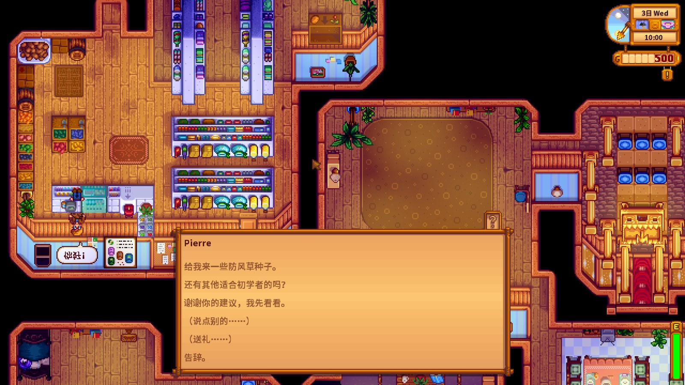
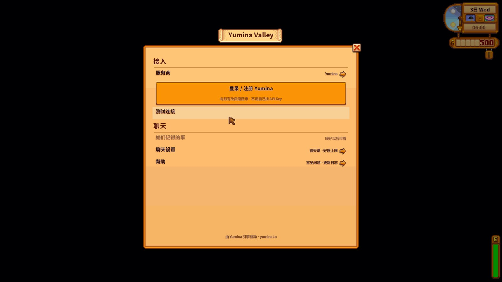

# Yumina Valley

A Stardew Valley mod: talk to any villager in Pelican Town in your own words.

[English](#english) · [中文](#中文)

**[Download the latest release](https://github.com/Cpjjason/yumina-valley/releases/latest)**

## English

Villagers remember what you said in this save and react to friendship, the weather and what you're holding. When they hand you something, lend you gold or make plans to meet, it really happens in the game.

### Install

1. Install [SMAPI](https://smapi.io) and run the game through it once.
2. Put the `YuminaValley` folder from the zip into the game's `Mods` folder
   (Steam: right-click Stardew Valley > Manage > Browse local files > Mods).
3. Start the game through SMAPI and load a save. Lewis sends a letter the day after you install it.

### Playing

- Walk up to a villager and press **Q**, then type what you want to say. After their reply, pick a suggested line, or "Say something else", "Give a gift" or "Goodbye".
- Press **F9** (or the top of the Options tab) for settings: sign-in, provider and model, the talk key, what each villager remembers, and help.
- On a festival day villagers follow the festival; Q works again the next day.

### Where villagers' words come from (pick one)

- **A Yumina account**: in the settings, "Sign in / sign up with Yumina" and sign in once in the browser. New accounts get free credits every month, no API key needed.
- **Your own API key**: Settings > Provider. Pick DeepSeek, OpenAI, OpenRouter, Gemini, Claude, xAI, Kimi, SiliconFlow, a local Ollama or a custom address, paste the key, pick a model and press "Test the connection". The key is kept in `config.json` on your PC and goes straight from your PC to the provider you picked.

### Optional

- With Generic Mod Config Menu installed, the settings are there too.
- Portrait and sprite mods (e.g. Content Patcher portrait packs) work alongside it.

### Uninstall

Delete the `YuminaValley` folder from `Mods`. Saves still load; villagers just stop talking back in your words.

### Problems

Press "Test the connection" in the settings. When reporting a problem, open an [issue](https://github.com/Cpjjason/yumina-valley/issues) and include your SMAPI log: `%AppData%\StardewValley\ErrorLogs\SMAPI-latest.txt` (you can upload it at https://smapi.io/log).

## 中文

用自己的话和鹈鹕镇的任何村民聊天。他们记得这个存档里你说过的话，看好感、天气和你手里的东西说话；答应给你的东西、借你的钱、约好的见面，游戏里都会真的发生。

### 安装

1. 先装 [SMAPI](https://smapi.io)，用 SMAPI 启动过一次游戏。
2. 把压缩包里的 `YuminaValley` 文件夹整个放进游戏的 `Mods` 文件夹
   （Steam：库里右键星露谷物语 > 管理 > 浏览本地文件 > Mods）。
3. 用 SMAPI 启动游戏，读档。装好后的第二天，刘易斯会寄来一封信。

### 怎么玩

- 走到村民面前按 **Q**，输入你想说的话。之后可以点推荐回复，或者选「说点别的」「送礼」「告辞」。
- 按 **F9**（或者菜单「选项」页最上面）打开设置：登录、换服务商和模型、改聊天键、看她们记得的事、帮助。
- 节日当天村民照节日安排来，Q 不能用，第二天再聊。

### 村民的话从哪来（二选一）

- **Yumina 账号**：在设置里点「登录 / 注册 Yumina」，浏览器登录一下就能聊。新账号每个月都有免费额度，不用自己找 API Key。
- **你自己的 API Key**：设置 > 服务商，选 DeepSeek、OpenAI、OpenRouter、Gemini、Claude、xAI、Kimi、硅基流动、本机 Ollama 或自定义接口，粘贴 Key，选模型，点「测试连接」。Key 存在这台电脑的 `config.json` 里，只从这台电脑直接发给你选的服务商。

### 可选

- 装了 Generic Mod Config Menu 的话，那里也能改设置。
- 换头像/立绘类的模组（比如 Content Patcher 立绘包）可以一起用。

### 卸载

删掉 `Mods` 里的 `YuminaValley` 文件夹就行。存档照常能读，只是不再有聊天和记忆。

### 出问题时

设置里点「测试连接」看能不能连上。报错请开 [issue](https://github.com/Cpjjason/yumina-valley/issues)，附上 SMAPI 日志：`%AppData%\StardewValley\ErrorLogs\SMAPI-latest.txt`（可以上传到 https://smapi.io/log）。
